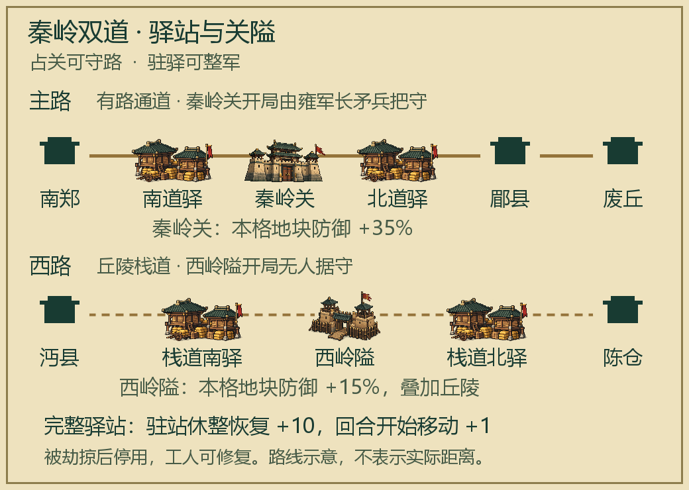

# 汉中困龙 · 两路出秦

v1.6.0 · 关山粮道 · 作者 Fog · 适配 Unciv 4.22.13

以公元前206年汉军还定三秦为背景的中文战役模组：44×32固定地图、四方势力、七座特色城池、四位像素名将、专属晋升、中途军议，以及可争夺和破坏的关隘粮道。

## 在游戏内下载安装

1. 打开 Unciv 主菜单的 **模组（Mods）**，搜索 **Hanzhong Trapped Dragon** 或 **汉中困龙**。
2. 如果搜索暂未显示，选择 **从网址下载模组（Download mod from URL）**，粘贴：
   `https://github.com/Done486/Hanzhong-Trapped-Dragon`
3. 下载后重新进入新建游戏，将**基础规则集**设为 **汉中困龙**，再按下方说明选择 Scenario。

已在 Unciv **4.22.13** 验证。模组包含完整规则与打包图集，无需其他模组。发布版本：[v1.6.0](https://github.com/Done486/Hanzhong-Trapped-Dragon/releases/tag/v1.6.0)；更新记录：[CHANGELOG.md](docs/CHANGELOG.md)。

手动安装时，将整个文件夹放入游戏的 `mods` 目录，并命名为 **Hanzhong Trapped Dragon**（单词间为空格），确保直接存在 `mods/Hanzhong Trapped Dragon/jsons/`。

## 开始战役

1. 确保已下载并选用 **汉中困龙** 基础规则集；手动安装不要多套一层文件夹。
2. 安装或更新模组后，重新打开 Unciv。
3. 进入 **新建游戏 → 地图创建方式：Scenario**，选择以下任一情景：
   - **汉中困龙 - 标准版 v1.6.0**：汉军初始 140 金币。
   - **汉中困龙 - 缓冲版 v1.6.0**：汉军初始 240 金币，额外拥有南郑城墙和强弩一队，首次体验推荐。
4. 默认由玩家操控汉国刘邦，其他三国由 AI 操控。要改玩雍、塞或翟，请把汉设为“电脑”，目标势力设为“玩家”；情景会自动进入所选玩家势力的回合。

两个情景都包含 44×32 的完整战役地图、七座预设城市、四名将领和固定交战关系。名将使用像素风头像与地图小人。

标准版和缓冲版的区别由情景初始部署决定。普通“自定义地图”主要提供地形，不包含完整战役部署。

## 继续进度与备用开局

继续自己的进度时，选择主菜单的 **载入游戏**。已有存档保留；旧版进度不会自动补齐新版开局经验与预设内容。本次公开版采用游戏在线下载的标准名称；先前手动版使用短横线目录名，若旧存档提示缺失模组，请保留原来的手动安装副本，不要删除存档。体验本次完整玩法，请从 v1.6.0 情景或备用开局重新开始。

`docs/Play-Now` 内保留两份固定操控汉国的 v1.6.0 开局存档作为备用；需要切换阵营请使用 Scenario 入口。需要时可手动复制到这份游戏的 `SaveFiles` 目录，再从“载入游戏”进入。

## 名将晋升

新开局四位名将各有10经验，选中己方名将即可打开“晋升”。每人有两条专属路线，每条两阶，共16项专属晋升；选定Ⅰ阶后锁定另一条路线，Ⅱ阶需要对应Ⅰ阶与足够经验。樊哙、曹参、章邯仍可选择普通近战晋升。电脑控制的名将由AI选择晋升。

| 名将 | 路线一 | 路线二 |
|---|---|---|
| 韩信 | 运筹Ⅰ → 决胜Ⅱ：2格统军光环从15%提升至20%、25%，取最高值。 | 行军Ⅰ → 抚军Ⅱ：移动+1，随后视野+1、相邻己方单位休整恢复+5。 |
| 樊哙 | 破城Ⅰ → 拔垒Ⅱ：自身攻城加成从25%提升至40%、50%。 | 追击Ⅰ → 奋战Ⅱ：移动+1，随后击杀敌军单位恢复15生命。 |
| 曹参 | 坚守Ⅰ → 御矢Ⅱ：自身防御加成从15%提升至30%，随后抗远程+20%。 | 续战Ⅰ → 护军Ⅱ：自身休整恢复额外+5，随后相邻己方单位休整恢复+5。 |
| 章邯 | 扼关Ⅰ → 据险Ⅱ：自身防御加成从20%提升至35%，随后丘陵作战+20%。 | 反击Ⅰ → 疾驱Ⅱ：主动攻击+15%，随后移动+1。 |

韩信每个本方回合结束获得1统军经验；其他将领主要靠战斗成长。专属晋升消耗正常晋升机会，初始10经验只够首次选择。恢复加成需要正常休整；名将阵亡不会补充。晋升使用玉色底、金色边的像素徽章，详细数值与规则可在晋升说明和文明百科查看。

## 中途军议

除汉国开局军议外，玩家控制的汉、雍、塞、翟均可依次召开三次中途军议。AI势力不额外领取这三次奖励。

| 阶段 | 开启时机 | 募兵方案 | 整军方案 | 军资方案 |
|---|---|---|---|---|
| 初阵 | 第8回合起，或首次夺城。 | 60金币：汉军锐士1队；三秦为剑士1队。 | 现有陆地军事单位战斗经验收益+25%。 | 获得50金币。 |
| 进退 | 完成初阵后，第20回合起，或再次夺城。 | 90金币：投石车1队。 | 现有陆地军事单位正常休整恢复+5生命。 | 获得80金币。 |
| 决胜 | 完成进退后，第35回合起，或再次夺城。 | 120金币：锐士、强弩各1队；三秦为剑士、复合弓兵各1队。 | 现有陆地军事单位主动攻击+10%战斗力。 | 获得120金币。 |

每章只选一策；军费不足时不显示付费方案。援军在己方城市附近加入。整军效果永久保留在获得时已在场的陆地军事单位上，不追溯后续新造部队，不消耗正常晋升机会。军议进度按势力保存，待处理军议不会每回合重复弹出，重载存档或反复夺城也不能重复领取同一章奖励。

军议采用像素风军帐地图插图、金色章节标题与中文方案说明；军议获得的整训、医营、奋勇各有独立徽章。

## 关隘与粮道

主路以道路和强关见长，西路保留丘陵与较少道路，适合绕行争取陈仓。两处关隘与四处驿站均预设在地图上；地块信息和文明百科可查看中文名称与效果。开局“军道图志”提供路线示意图。

| 据点 | 位置 | 用途 |
|---|---|---|
| 秦岭关 | 主路山口，(-3,2) | 本格额外+35%地块防御。开局将郿县附近原有的一队雍军长矛兵前移至此，没有额外增加兵力。 |
| 西岭隘 | 西侧丘陵通道，(6,-7) | 本格额外+15%地块防御，与丘陵叠加；开局无人据守。 |
| 南道驿 | 南郑北侧道路，(-7,-3) | 主路入山前整备。 |
| 北道驿 | 秦岭关以北、郿县以南，(-1,4) | 越关后轮换休整。 |
| 栈道南驿 | 沔县至西侧山路入口，(3,-10) | 侧路出发与护送工人的落脚点。 |
| 栈道北驿 | 西侧山路出口、陈仓南侧，(8,-2) | 出山后的休整支点。 |

四处驿站效果相同：陆地单位在完整驿站本格正常休整时，额外恢复10生命；从完整驿站开始本方回合时，移动力+1。双方均可使用，须实际驻入本格。路过不会返还行动点，行动后也不会自动回血，邻近部队不共享该驿站补给。

驿站可被劫掠，两项补给效果随即停用；工人可在非敌对领土执行“修复”重新启用。若驿站已处敌方领土，须先夺取所属城池。自动工人不会替换驿站；手动改建其他设施会拆除驿站，驿站不能另造。关隘不可另造、拆除或劫掠，依靠部队占位控制，原有地形与交战规则继续生效。

主路补齐南郑北侧两格道路，西路仍须应对较慢的丘陵行军。道路的移动收益遵循游戏原有领土、科技和控制区规则。建议攻关前集中部队，越关后护住驿站与修路工人，再决定向郿县正面推进还是转向陈仓。

## 城池特色

每城预设一处特色设施，不能建造、购买或出售。攻城时保留，归新主人使用；双方势力都能享受其控制城池的特色。城市产出受抵抗、傀儡等正常规则修正。

| 城池 | 特色 | 效果与用途 |
|---|---|---|
| 南郑 | 南郑府库 | +3金币、+1生产力；维持军费与后方生产。 |
| 沔县 | 沔县栈道驿 | +2食物、+2生产力；经营副城，补充部队与工人。 |
| 陈仓 | 陈仓转运营 | +1食物；己方陆军在本城中心或相邻格正常休整时额外恢复10生命。 |
| 郿县 | 郿县关防 | +2城防强度、+25城市生命上限；夺取后可用于抵御反攻。 |
| 废丘 | 废丘武库 | +2生产力；本城训练的新军事单位额外获得10经验，可叠加兵营等设施。 |
| 栎阳 | 栎阳粮市 | +2食物、+3金币；支撑关中经营。 |
| 高奴 | 高奴马苑 | 提供1战马资源；本城训练骑乘单位时+25%生产力。 |

食物、金币和生产力为城市基础产出加成；战马是可用资源容量，不会每回合累积。陈仓的恢复加成需要正常休整，行动后不会自动回血。特色随城转交，不发放可反复刷取的攻城礼包。

推荐西路先争陈仓以建立休整点；主路郿县关防更坚固，但攻下后能守住通道。三个原始都城仍是最终目标，各自兼有训练、粮钱和骑兵价值。

新开局会显示“城邑军情”提示，城内建筑列表和文明百科可查看具体效果。这些设施均为玩法设计，不代表历史建筑复原。

## 战役目标

- 保有南郑，夺取废丘、栎阳、高奴三座原始都城，完成“还定三秦”。
- 南郑失守则失败；上限 120 回合，届时按分数结算。
- 汉与三秦全程交战。东北主路较短、有道路，西北侧路较长、山地多。
- 韩信是统军文职单位，可与己方军队同格；樊哙、曹参、章邯是军事单位。四人不可生产或购买，阵亡不再补充。
- 缓冲版比标准版多南郑城墙、强弩一队、100 金币。

## 文件与许可

`jsons` 为规则与中文翻译；`maps` 为地形地图；`scenarios` 为情景；`docs/Play-Now` 为两份新版战役开局。图集与图片均供游戏运行使用。

本精简版移除了旧版开局、测试日志、开发源素材、重复安装器与图文手册，保留游玩所需内容。

非官方爱好者模组。新增单位能力、兵力和驻地为玩法设计，人物立绘为艺术创作。许可证为 MPL 2.0，详见 `LICENSE.md` 和 `docs/licenses/Unciv-MPL-2.0.txt`。
